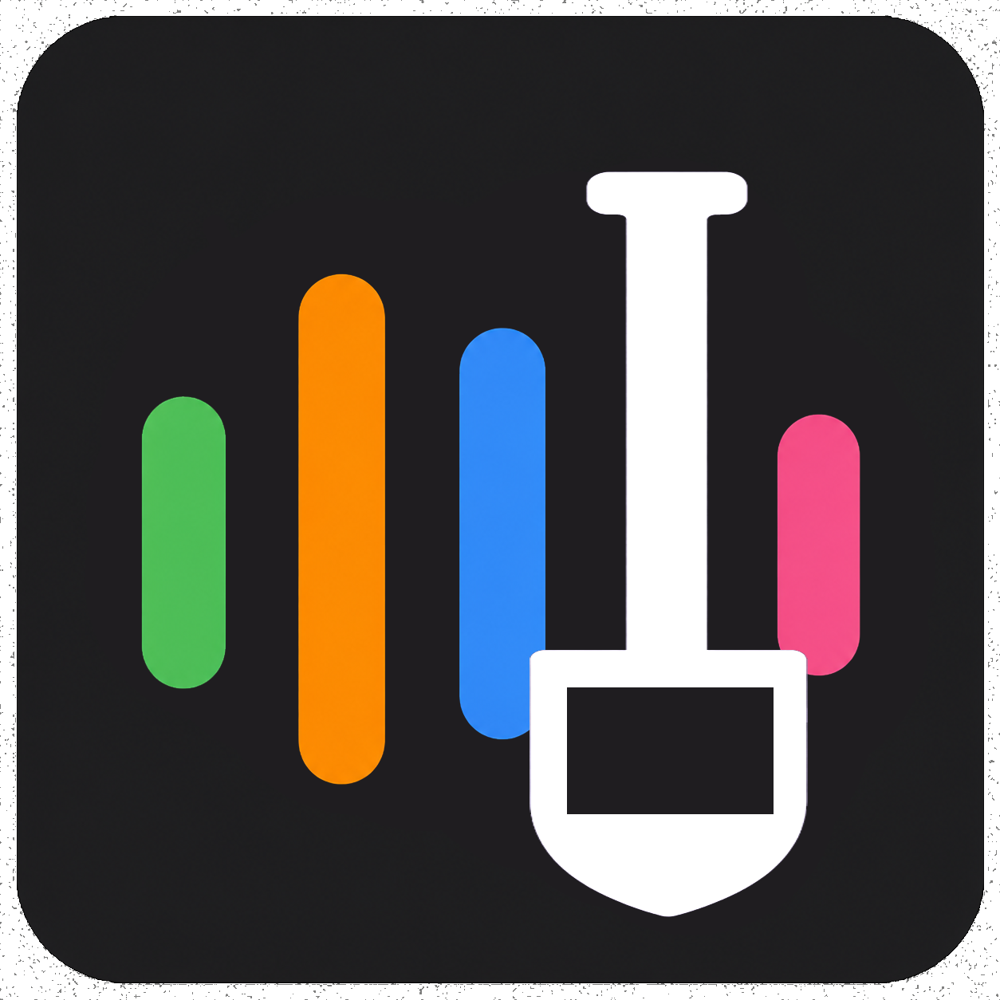

<p align="right"><a href="../README.md">English version</a></p>

<p align="center">
  
</p>

<h1 align="center">GPT Grabber</h1>

<p align="center">
  <b>Голосовой ввод для всего компьютера.</b><br>
  Диктуешь, ChatGPT распознаёт, текст попадает в окно, где ты работаешь. Одна клавиша.
</p>

<p align="center">
  
  
  
  
</p>

<p align="center">
  <a href="https://github.com/paperisque/gptbridge/raw/master/dist/GptGrabber-Setup-0.1.9.exe"></a>
</p>

<p align="center">
  <a href="#что-нового-в-019">Что нового</a> ·
  <a href="#клавиши">Клавиши</a> ·
  <a href="#режимы-диктовки">Режимы</a> ·
  <a href="#меню-трея">Меню трея</a> ·
  <a href="#установка">Установка</a> ·
  <a href="#распознать-файл-из-другой-программы">Файлы от других программ</a> ·
  <a href="#полезно-знать">Полезно знать</a>
</p>

---

GPT Grabber встраивает ChatGPT через **WebView2** (движок Chromium, встроенный в Windows), сам нажимает кнопки диктовки, забирает распознанный текст и вставляет его в активное окно: VS Code, редактор, мессенджер, что угодно. Одно маленькое приложение в трее. Ни внешнего браузера, ни расширения, ни сервера, за которым надо присматривать.

## Что нового в 0.1.9

- **Режимы потока.** Слова появляются в твоём окне прямо во время речи. «Поток-авто» сам останавливается после 6 секунд тишины и сам включается, когда заговоришь, не теряя начала фразы. → [Режимы диктовки](#режимы-диктовки)
- **Меню трея.** Любая команда клавиш в один щелчок, плюс переключатели режима и звука. → [Меню трея](#меню-трея)
- **Новая справка.** Панель **?** теперь аккуратная страница: клавиши кнопками, номер версии и ссылка на этот репозиторий.
- **Выключатель звука.** Все пики включаются и выключаются из меню трея, выбор запоминается.

Вся история - в [списке изменений](CHANGELOG.ru.md).

## Чем полезен

| | |
|---|---|
| 🎯 **Качество ChatGPT везде** | Пунктуация, много языков, терпимость к бормотанию. Не только внутри чата, а в любом приложении. |
| 💸 **Не нужен отдельный платный диктофон** | Используется диктовка, которая уже есть в твоём аккаунте ChatGPT (по духу похоже на WhisperFlow). |
| ⌨️ **Не отрываешься от работы** | Одна клавиша из любого приложения. Окно живёт в трее, микрофон работает и в скрытом окне. |
| 👀 **Видно, что происходит** | Маленькая «пилюля» у курсора или внизу экрана: готовлю, идёт запись, распознаю, вставлено. Иконка в трее меняет цвет вместе с ней. |
| 🔌 **Пользоваться могут и другие программы** | HTTP-вход превращает WAV-файл в текст для программ на этом компьютере и в сети, с вежливой очередью: твоя собственная диктовка всегда первая. |

## Клавиши

| Клавиши | Действие |
|---|---|
| **Ctrl+Win** | Диктовка: старт → говоришь → стоп → вставка в активное окно |
| **Ctrl+Win+Y** | То же, но текст ещё и остаётся в буфере обмена |
| **Win+Alt** | Снова вставить последний распознанный текст |
| **Shift+Win** (во время «Потока») | Продолжить поток в окне, где ты сейчас |
| **Ctrl+Win** (пока готовлю / распознаю) | Отмена |

Тот же список открывается кнопкой **?** в окне программы. Клавиша «+буфер» узнаётся по физическому положению, поэтому работает в любой раскладке (Y на немецкой, Z на английской, Я на русской).

## Режимы диктовки

Режим переключают две круглые кнопки в правом нижнем углу окна ChatGPT. Программа всегда запускается в режиме «Обычный».

- **Обычный.** Текст вставляется один раз, после стопа.
- **Поток.** Слова вставляются прямо во время речи, примерно раз в полсекунды. Запись сама не заканчивается; после 5 секунд тишины одинарный пик раз в 5 секунд напоминает, что микрофон включён. 5 минут после стопа голос напоминает, что запись выключена.
- **Поток-авто.** Как «Поток», но 6 секунд без новых слов заканчивают запись (отсчёт в пилюле, пик раз в 2 секунды). 5 минут после этого голос сам включает запись снова, и начало фразы не теряется: программа слушает с коротким буфером и передаёт его ChatGPT. Стоп по Ctrl+Win усыпляет автозапуск до следующего своего старта.

Щелчок по кнопке «Поток» открывает над ней выбор: «Поток-авто» или «Поток». Жёлтая «A» на кнопке означает «Поток-авто».

## Меню трея

Одиночный щелчок по значку в трее (левой или правой кнопкой) открывает меню с теми же командами, что и клавиши: начать, остановить и вставить, остановить и оставить в буфере, отменить, вставить ещё раз, продолжить поток в другом окне. Список меняется по состоянию. Ниже: три режима, «Звук» вкл/выкл, «Показать», «Выход». Двойной щелчок открывает окно.

Команда из меню идёт в окно, где ты был до щелчка по трею: программа его запоминает, выводит вперёд, и текстовый курсор встаёт на прежнее место.

## Установка

**Скачай** готовый установщик: [GptGrabber-Setup-0.1.9.exe](https://github.com/paperisque/gptbridge/raw/master/dist/GptGrabber-Setup-0.1.9.exe) (около 53 МБ). Или собери его сам одной командой из корня репозитория:

```powershell
powershell -ExecutionPolicy Bypass -File tools\build-installer.ps1
```

Получится `dist\GptGrabber-Setup-<версия>.exe`. Установщик:

- ставит **для текущего пользователя, без прав администратора**, в `%LOCALAPPDATA%\GptGrabber`;
- кладёт рядом **портативный .NET 10 runtime**: программа запускается через подписанный Microsoft `dotnet.exe`, поэтому Smart App Control её не блокирует;
- ставит **Microsoft Edge WebView2 Runtime**, если его нет (на Windows 11 он обычно уже есть);
- **ничего не спрашивает**: запустил, поставилось, готово. Ярлыки в меню Пуск и на рабочем столе появляются сами.

При первом запуске один раз войди в ChatGPT прямо в окне программы. Сессия сохранится.

## Запуск из исходников

Нужны **.NET 10 SDK** и **WebView2 Runtime**.

```powershell
cd poc-webview2
dotnet run
```

Отдельный `.exe` не собирается: Windows Smart App Control блокирует неподписанный. Запуск всегда идёт через доверенный `dotnet`. Для постоянного ярлыка укажи `dotnet.exe`, а путь к DLL дай аргументом.

### Флаги командной строки

Флаги идут **после** пути к DLL: `dotnet "…\WebView2Poc.dll" <флаги>`.

- `--lang en|de|ru` задаёт язык интерфейса. По умолчанию берётся язык Windows.
- `--tray` запускает сразу в трей.
- `--no-beep` выключает все звуки на старте (то же, что пункт «Звук» в меню трея).
- `--api-host АДРЕС` задаёт, где слушает вход для других программ. По умолчанию `0.0.0.0`, то есть вся сеть. `127.0.0.1` оставит вход только этому компьютеру.
- `--api-port N` задаёт порт входа. По умолчанию `17891`.
- `--devtools-port N` открывает отладочный порт Chromium на `127.0.0.1:N`, чтобы разглядеть встроенную страницу, когда ChatGPT снова поменяет разметку. **Держи выключенным, если не отлаживаешь:** пока порт открыт, любая программа на этом компьютере может управлять страницей и добраться до твоей сессии ChatGPT.

## Распознать файл из другой программы

GPT Grabber слушает порт **`17891`**. Любая программа на этом компьютере или на другом компьютере в сети может прислать ему WAV-файл и получить распознанный текст. Внутри граббер проигрывает файл в диктовку ChatGPT вместо микрофона: в колонках тишина, никуда ничего не вставляется, буфер обмена и фокус не трогаются.

### Кто может обратиться

- **Этот компьютер** обращается по `http://127.0.0.1:17891`.
- **Другие компьютеры в сети** обращаются по адресу компьютера с граббером, например `http://192.168.1.20:17891`. Адреса этого компьютера граббер пишет в журнал при старте.
- **Не веб-страницы.** Запрос с заголовком `Origin`, то есть со страницы в браузере, получает `403`. Заголовок `Host` должен быть IP-адресом, `localhost` или именем этого компьютера с портом входа, иначе тоже `403`. Это закрывает фокусы с подменой DNS.
- **Ключа нет.** Вход открыт всем, кто видит компьютер в сети. Если это лишнее, флаг `--api-host 127.0.0.1` оставит его только этому компьютеру. Порт меняет флаг `--api-port`.

При первом запуске Windows может спросить, пускать ли программу в сеть. Для разрешения могут понадобиться права администратора. Без разрешения вход работает только для этого компьютера.

### Простой путь в три шага

**1. Убедиться, что граббер запущен.** Он работает из трея. Если нет, запусти его скрытым:

```bat
"%LOCALAPPDATA%\GptGrabber\dotnet\dotnet.exe" "%LOCALAPPDATA%\GptGrabber\WebView2Poc.dll" --tray
```

Повторный запуск безвреден: он просто покажет уже работающую копию. Старт занимает несколько секунд, поэтому опрашивай статус до 20 с.

**2. Спросить статус.**

```powershell
curl.exe -s http://127.0.0.1:17891/status
```

```json
{"ready":true,"state":"idle","reason":"","version":"0.1.8","maxAudioSec":360}
```

`ready:true` значит «заходи». `state` бывает `idle`, `live` (человек диктует) или `file` (идёт чужой файл). `reason` объясняет, почему не готов: `live`, `file`, `pause` или `not_ready`. Когда есть оценка, `retryAfterSec` подсказывает, когда приходить снова.

**3. Отправить файл.** Либо сам WAV в теле запроса, так можно с любого компьютера:

```powershell
curl.exe -s -H "Content-Type: audio/wav" --data-binary "@C:\path\to\voice.wav" http://127.0.0.1:17891/transcribe
```

Присланный файл ложится копией в папку входящих `data\inbox` рядом с программой. После успешного распознавания копия удаляется, неудачные остаются для разбора.

Либо путь к файлу в JSON. **Только с этого компьютера:** путь указывает на диск граббера, поэтому с другой машины граббер его не примет. Кириллица и пробелы в пути не мешают, тело в UTF-8:

```powershell
$json = @{ path = 'C:\Голосовые\запись 1.wav' } | ConvertTo-Json
Invoke-RestMethod http://127.0.0.1:17891/transcribe -Method Post `
  -ContentType 'application/json; charset=utf-8' -Body ([Text.Encoding]::UTF8.GetBytes($json))
```

Ответ приходит, когда текст готов. ChatGPT слушает в реальном времени, поэтому минутный файл занимает около минуты плюс несколько секунд. Ждать ответа стоит не меньше `длина звука + 60 с`.

```json
{"id":"gg-20261109-141008-0003","requestId":"","text":"Представьте мои чувства в тот момент…","audioSec":20,"recognizeMs":1003}
```

> **Ловушка PowerShell.** В Windows PowerShell слово `curl` означает вовсе не curl, а встроенную команду `Invoke-WebRequest`, которая не понимает `-s` и `-H`. Пиши `curl.exe`.

### Необязательные заголовки

- `X-Client: MyBot` - имя твоей программы.
- `X-Request-Id: mybot-0001` - твой номер запроса. Он вернётся в ответе как `requestId`.

Оба попадают в журнал граббера, по ним легко найти, кто что спрашивал.

### Ответы

| Код | `error` | Что случилось | Что делать |
|---|---|---|---|
| 200 | | Текст в поле `text` | Пользоваться |
| 409 | `busy` | Граббер занят: человек диктует, только что закончил или идёт другой файл | Подождать `retryAfterSec` (если есть) и повторить |
| 409 | `preempted` | Человек нажал Ctrl+Win посреди твоего файла, файл сброшен | Позже прислать весь файл заново |
| 503 | `not_ready` | Страница ChatGPT не готова (грузится, нет кнопки диктовки) | Повторить через несколько секунд |
| 503 | `session` | Сессия ChatGPT протухла, человеку надо заново войти в окне программы | Сказать человеку |
| 400 | `bad_file` | Файла нет, это не WAV, он не читается или путь пришёл с другого компьютера | Исправить запрос, по сети слать сам файл |
| 413 | `too_long` | Длиннее 360 с | Порезать на куски |
| 422 | `empty` | Текста не вышло, скорее всего тишина | Распознавать нечего |
| 504 | `timeout` | Распознавание не закончилось за 60 с | Повторить |

В каждом ответе с ошибкой есть `id`, `requestId`, `error` и понятное человеку `message`.

### Кто первый

Человек за клавиатурой всегда главнее. В этом весь этикет:

- **Пока человек диктует сам,** файлы получают `busy` без оценки: сколько человек будет говорить, не знает никто.
- **Ещё 10 с после каждой диктовки** файлы тоже получают `busy`, а `retryAfterSec` показывает остаток. Каждая новая диктовка отсчитывает 10 с заново. Люди часто диктуют очередями, и файл, проскочивший в паузу, мешал бы.
- **Если человек нажал Ctrl+Win во время файла,** файл сбрасывается сразу, программа получает `preempted`, а диктовка человека начинается немедленно.
- **Файл одновременно только один.** Следующий получает `busy` с оценкой: остаток текущего звука плюс около 3 с.
- **Если твоя программа бросила трубку** посреди запроса, граббер прекращает подачу файла и сразу свободен. Брошенная работа следующему не мешает.

Поэтому воспитанный клиент - это простой цикл: отправил, на `409` подождал `retryAfterSec` (или несколько секунд) и отправил снова.

```powershell
do {
  try { $r = Invoke-RestMethod http://127.0.0.1:17891/transcribe -Method Post -ContentType 'audio/wav' -InFile 'C:\path\to\voice.wav'; break }
  catch {
    if ($_.Exception.Response.StatusCode.value__ -ne 409) { throw }
    $e = $_.ErrorDetails.Message | ConvertFrom-Json
    Start-Sleep -Seconds ([Math]::Max(3, [int]$e.retryAfterSec))
  }
} while ($true)
$r.text
```

### Известное ограничение

Пока идёт файл, не нажимай руками кнопки диктовки на странице ChatGPT. Граббер этого пока не замечает: он дождётся конца звука и может вернуть обрывок текста или `timeout`. Ctrl+Win работает правильно. Исправление уже в работе.

## Полезно знать

- **Живёт в трее.** Крестик (×) прячет окно в трей. Выход через меню трея.
- **Один экземпляр.** Повторный запуск разворачивает уже работающую копию из трея, а вторую не создаёт.
- **Звуки.** Короткий двухтональный «дин-дон» подтверждает вставку; одинарные пики отсчитывают и напоминают в режимах потока. Пункт «Звук» в меню трея выключает и включает их все, выбор запоминается. Флаг `--no-beep` выключает их на старте.
- **ChatGPT поопрятнее.** Встроенная страница прячет лишнее вокруг поля ввода, чтобы оно не прыгало в маленьком окне.
- **Где данные.** Профиль ChatGPT и журнал `poc.log` лежат рядом с программой, в папке `data`: `%LOCALAPPDATA%\GptGrabber\data` у установленной версии, `poc-webview2\bin\Debug\net10.0-windows\data` у сборки разработчика. Удаление программы удаляет и её.
- **Нет окна консоли.** Программа запускается через консольный `dotnet.exe`, поэтому на старте перезапускает себя без окна. Возможно короткое мелькание.

Детали реализации и грабли - в [CLAUDE.md](../CLAUDE.md), раздел 8.

---

<sub>Прежняя версия проекта, диктовка во вкладке Firefox через расширение и C#-хаб с сетевыми клиентами, лежит в [server-csharp/](../server-csharp/) и [extension-firefox/](../extension-firefox/README.md). Она оставлена как есть и здесь больше не описывается.</sub>
